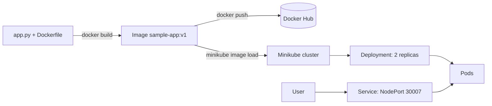

# DevOps Lab 2: Containerization and Kubernetes Orchestration

A Flask web application that is containerized with Docker, published to Docker Hub and deployed to a local Kubernetes (Minikube) cluster. The project covers image builds, container management, Docker Compose, Docker storage and networking, Kubernetes Deployments and Services, scaling, rolling updates, rollbacks and a Jenkins pipeline definition for continuous deployment.

**Author:** Akshita Sharma ([@Akshita04987](https://github.com/Akshita04987))
**Course:** DevOps and Automation Lab (ENSP461), Lab 2
**Docker Hub image:** [akshitasharma24/sample-app](https://hub.docker.com/r/akshitasharma24/sample-app)

---

## Contents
1. [Architecture](#architecture)
2. [Tech stack](#tech-stack)
3. [Project structure](#project-structure)
4. [Prerequisites](#prerequisites)
5. [Build and run with Docker](#build-and-run-with-docker)
6. [Manage containers and images](#manage-containers-and-images)
7. [Docker Compose](#docker-compose)
8. [Docker storage](#docker-storage)
9. [Docker network](#docker-network)
10. [Deploy to Kubernetes](#deploy-to-kubernetes)
11. [Scaling, rolling update and rollback](#scaling-rolling-update-and-rollback)
12. [Continuous deployment (Jenkinsfile)](#continuous-deployment-jenkinsfile)
13. [Observations](#observations)

---

## Architecture



- The **Dockerfile** packages the Flask app into the image `sample-app`.
- A **Deployment** keeps the desired number of pod replicas running.
- A **NodePort Service** exposes the pods (service port 80, container port 5000, node port 30007).

## Tech stack
| Area | Tool |
|---|---|
| Application | Python 3.9, Flask |
| Containers | Docker Desktop |
| Orchestration | Kubernetes (Minikube, kubectl) |
| Registry | Docker Hub |
| Multi-container | Docker Compose |
| CI/CD | Jenkins (Jenkinsfile), GitHub |

## Project structure
```text
DevOps-Lab2/
├── app.py                 # Flask application
├── requirements.txt       # Python dependencies
├── Dockerfile             # Image definition
├── deployment.yaml        # Kubernetes Deployment (2 replicas)
├── service.yaml           # Kubernetes NodePort Service
├── docker-compose.yml     # Web + Redis multi-container setup
├── Jenkinsfile            # Continuous deployment pipeline definition
├── .gitignore
└── README.md
```

## Prerequisites
- Docker Desktop (running)
- Minikube and kubectl
- Git

## Build and run with Docker
```bash
docker build -t sample-app:v1 .
docker run -d -p 5000:5000 --name my-running-app sample-app:v1
docker history sample-app:v1
docker ps
```
Open http://localhost:5000 to see the application.

**Image layers** (from the Dockerfile):

| Instruction | Purpose |
|---|---|
| `FROM python:3.9-slim` | Base image with Python |
| `WORKDIR /app` | Working directory inside the image |
| `COPY requirements.txt .` | Adds the dependency list |
| `RUN pip install --no-cache-dir -r requirements.txt` | Installs Flask in its own cached layer |
| `COPY . .` | Adds the application code |
| `EXPOSE 5000` | Documents the application port |
| `CMD ["python", "app.py"]` | Start command |

Because dependencies are installed before the code is copied, rebuilding after a code change reuses the cached dependency layer and is fast.

## Manage containers and images
```bash
docker ps -a                                   # list containers
docker stop my-running-app                     # stop a container
docker start my-running-app                    # start a container
docker run -d --name test1 nginx:alpine        # create a test container
docker stop test1 && docker rm test1           # stop and remove it
docker tag sample-app:v1 akshitasharma24/sample-app:v1
docker push akshitasharma24/sample-app:v1      # push to Docker Hub
docker images
```

## Docker Compose
`docker-compose.yml` starts the web application (host port 5001) together with a Redis cache.
```bash
docker compose up -d
docker compose ps
docker compose down
```

## Docker storage
Data written to a container's own layer is deleted with the container. A named volume or a bind mount keeps it.

```bash
# 1. Data in the container layer is lost after the container is deleted
docker run -d --name tmp1 alpine sh -c "echo hello > /data.txt && sleep 600"
docker exec tmp1 cat /data.txt
docker rm -f tmp1
docker run --rm alpine cat /data.txt        # error: No such file or directory

# 2. Named volume (persistent)
docker volume create mydata
docker run --rm -v mydata:/data alpine sh -c "echo saved > /data/file.txt"
docker run --rm -v mydata:/data alpine cat /data/file.txt     # prints: saved

# 3. Bind mount (host folder)
mkdir hostdata
docker run --rm -v "${PWD}\hostdata:/data" alpine sh -c "echo bind > /data/b.txt"
dir hostdata                                # b.txt exists on the host
```

## Docker network
Two containers on a user-defined bridge network can reach each other by name and by IP address.
```bash
docker network create mynet
docker run -d --name web1 --network mynet nginx:alpine
docker run -d --name box1 --network mynet alpine sleep 600
docker exec box1 ping -c 2 web1                          # by container name
docker inspect -f "{{range .NetworkSettings.Networks}}{{.IPAddress}}{{end}}" web1
docker exec box1 ping -c 2 172.18.0.2                    # by IP address
```

## Deploy to Kubernetes
```bash
minikube start
minikube image load sample-app:v1
kubectl apply -f deployment.yaml
kubectl apply -f service.yaml
kubectl get deployments
kubectl get pods
kubectl get svc
```
`imagePullPolicy: Never` is set so that Kubernetes uses the image loaded into Minikube.

## Scaling, rolling update and rollback
```bash
# Scale to 4 replicas, then back to 2
kubectl scale deployment sample-deployment --replicas=4
kubectl scale deployment sample-deployment --replicas=2

# Rolling update to v2
docker build -t sample-app:v2 .
minikube image load sample-app:v2
kubectl set image deployment/sample-deployment sample-app=sample-app:v2
kubectl rollout status deployment/sample-deployment
kubectl rollout history deployment/sample-deployment

# Roll back to the previous version
kubectl rollout undo deployment/sample-deployment
```

## Continuous deployment (Jenkinsfile)
The `Jenkinsfile` defines a declarative pipeline that automates the deployment:

| Stage | What it does |
|---|---|
| Checkout | Pulls the code and manifests from GitHub |
| Build Image | `docker build -t sample-app:v1 .` |
| Deploy to Kubernetes | `kubectl apply -f deployment.yaml`, `kubectl apply -f service.yaml`, then `kubectl rollout status deployment/sample-deployment` |

The pipeline uses `bat` steps, so it is meant for a Jenkins agent that runs on the same Windows machine as Docker and Minikube. To use it, create a Jenkins Pipeline job with *Pipeline script from SCM*, this repository URL and the script path `Jenkinsfile`.

## Observations
- The Flask application ran the same way in a Docker container and on Kubernetes.
- After `kubectl apply`, both pods reached the Running state and the NodePort service exposed the application on port 30007.
- Scaling from 2 to 4 replicas took a few seconds.
- The rolling update replaced the pods gradually, and `kubectl rollout undo` returned the deployment to the previous revision.
- Container-layer data is lost with the container, while a named volume and a bind mount keep data.
- Containers on a user-defined network can reach each other by name and by IP address.
- Docker layer caching made repeated builds fast.
